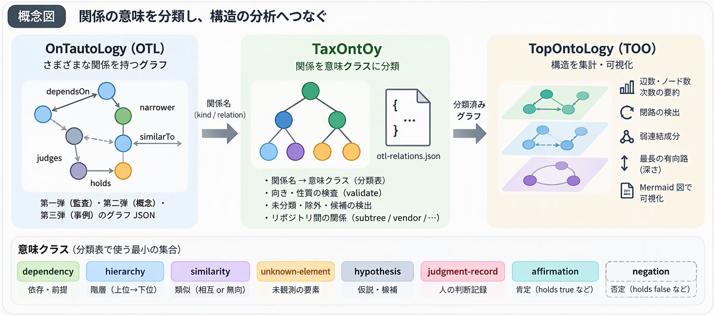

# TaxOntOy


[otl-relations.json](otl-relations.json) は OnTautoLogy の第一弾（監査）、第二弾（概念）、第三弾（事例）の関係を、分析したい意味に対応づける最小の分類表です。キーは OTL のグラフ JSON に現れる関係名です。元の辺の向きと ID を保持します。

 [ファビコン（32 × 32）](docs/assets/favicon.png)

[](docs/assets/taxontoy-overview.jpg)

図の右列は構造分析を担当する TopOntoLogy（TOL）です。

第二弾では上位から下位へ向かう `narrower` と、両方向が別の辺になる `similarTo` を別々に集計します。第三弾では候補、人の判断記録、肯定を別々に数えます。否定クラス `negation` は知っていますが、固定した事例グラフに `holds false` の辺が無いので表には入れていません。その辺が現れたら未分類になり、検査が失敗します。未登録の関係は元のグラフに残ります。TopOntoLogy の `topology.py` は各弾のオブジェクトを関係名からクラス名への対応として読み、分類ごとの構造を集計します。OnTautoLogy が事例の判定を担当します。

## 表の形

[otl-relations.schema.json](otl-relations.schema.json) が形です。検査そのものは標準ライブラリの `taxontoy validate` が行います。

- `audit` / `concepts` / `cases` の値はクラス名の文字列です。TopOntoLogy はこの形のまま読めます。
- クラスは `dependency`、`overlap`、`hierarchy`、`similarity`、`unknown-element`、`hypothesis`、`judgment-record`、`affirmation`、`negation` だけです。
- `direction` は分類した関係すべての向きです。`forward` は一方向、`mutual` は両方向を別の辺として保存、`undirected` は向きが無くグラフ JSON では一方向だけ記録します。クラスと向きが食い違うと検査は失敗します。
- `excluded` はグラフに現れるが、その弾の意味クラスには入れない関係です。`taxontoy-relations/2` では関係名の配列です。並べて重複なく書きます。`taxontoy-relations/3` では各要素がオブジェクトです。`relation`、`kind`、`since`（YYYY-MM-DD）、`reason` が要ります。`kind` は `out_of_scope` か `alias` です。`alias` は同じプロファイルで分類済みの正規の関係を `alias_of` で指します。`depends_on` は `dependsOn` の別名で、同じ端点の組が 13 件あります。`overlapsWith` は `duplicates` の別名です。`out_of_scope` に `alias_of` は書けません。分類と除外の両方に入る名前は失敗です。検査は `taxontoy-relations/2` もそのまま読みます。
- オブジェクトのキーが重複している JSON は失敗です。
- `properties` はクラスまたは関係ごとの性質です。使える名前は `transitive`、`symmetric`、`inverse_of`、`acyclic`、`disjoint_with` です。各宣言には `since`（YYYY-MM-DD）と `reason` が要ります。`inverse_of` は表にある相手を指し、相手も自分を逆として宣言していなければなりません。`symmetric` と `acyclic` は同時に宣言できません。`disjoint_with` が自分自身を指すと失敗です。クラスに書いた性質は、そのクラスの関係に引き継がれます。関係には任意で `domain` と `range` を書けます。値はノード型の配列 `types` と、`since`、`reason` です。型名は並べて重複なく書きます。`domain` は source の型、`range` は target の型です。宣言した側に無い型の辺は違反です。型が読めない端点も宣言の外です。ノードに型が無いグラフでは、この検査は省きます。

`dependsOn` は依存する側から前提への `forward`、`duplicates` は `undirected`、`narrower` は上位から下位への `forward`、`similarTo` は `mutual` です。

`repos` はリポジトリ同士の関係です。表に無くても `taxontoy-relations/2` のまま通ります。あるときは他のプロファイルと同じで、`direction` と `excluded.repos` が要ります。`audit` / `concepts` / `cases` の意味はそのままです。

公開リポジトリの記録に合わせ、提案名は次の表の名前にしています。

| 提案 | 表の名前 | 記録 |
| --- | --- | --- |
| `subtree-of` | `subtree` | Aoi の `child-heads.json` の `optional.subtree_prefix`。親リポジトリ `myon-bioinformatics/myon-bioinformatics` の `gh_ops.py` `subtree-push`（`1e6fce6cc2eda0717ef495c4355a6e19a3cf66ba`）。fleet の kind は `subtree` |
| `vendors` | `vendor` | `vendor-lock/1` の `files`。fleet の kind は `vendor`。launcher と license は fleet では別 kind で、表では lock のファイル行をすべて `vendor` にします |
| `pins` | `workflow-pin` | workflow の `uses: owner/repo@SHA` と、checkout の `repository` と `ref`。fleet の kind は `workflow-pin` |
| `consumes` | `consumes` | `aoi.py` の `SIBLINGS`。子が別の subtree ディレクトリを import します。fleet の `shared-tools` は別の consumer 記録です |

`source` はパスを持つリポジトリ、`target` は相手です。リポジトリ名は `owner/name` に揃え、`https://github.com/` と `git@github.com:` と末尾の `.git` を外し、大文字小文字を区別しません。`subtree`、`vendor`、`consumes`、`workflow-pin` の端点は同じ規則で折るので、表記が違ってもノードは一つです。出典の `repo` はマニフェストに書いた表記のままです。`subtree` は親から子で、`path` は prefix です。`vendor` はコピーを持つリポジトリから上流で、`path` は destination です。`prefix/vendor.lock.json` は親ではなく、その prefix の子のロックです。`workflow-pin` は workflow のあるリポジトリから固定先で、`path` は workflow ファイル、`pin` は小文字の SHA です。`uses:` の引用符と大文字の SHA を受けます。`repository` と `ref` は `actions/checkout` のステップから取ります。`consumes` は子から import 先で、配布パスは付けません。

パスの `.` は捨てます。`..` や空のパスはファイルの同一性になりません。`path` がある辺は、正規化できないときに端点だけの比較へは倒れません。`subtree` と `vendor` の違反は、パスが無くても `double_distribution` の件数に入ります。

`taxontoy graph --manifest` が読むファイルは、解決したあともマニフェストのディレクトリの中にあります。シンボリックリンクは、指す先がディレクトリの中でも外でも失敗です。

`subtree` と `vendor` は `disjoint_with` です。`source` が同じで `path` が一致する、または一方が他方のディレクトリ接頭辞であるとき、同じファイルとリポジトリの組を二通りに配っています。`taxontoy properties` は違反と、その辺を報告します。違反が無いときの終了コードは 0、あるときは 1、`--strict` のときは 2 です。

リポジトリの関係は、既存の OTL グラフ JSON（`nodes` と `edges`、関係名は `kind` または `relation`）で表します。記録から辺を作る `taxontoy graph` は、マニフェストに書いたファイルだけを読みます。マニフェストを省くと `fixtures/repos/manifest.json` を使います。

実データは Aoi `320126983a992e30730350c5e9b0e4051c0d33d4`、TopOntoLogy `7c0823b4e9c7ec541d1a1f14c77ac85b72b83cb3`、OnTautoLogy `1909829db345870361ad5c6368bdf2adc199459c` です。この範囲の二重配布は 0 件です。出典は [fixtures/repos/manifest.json](fixtures/repos/manifest.json) に repo、commit、path で残しています。

## 被覆

`taxontoy coverage` は、渡した OTL グラフの関係名を、分類済み・除外・未分類に分けます。三つの集合は互いに重ならず、足すとグラフに現れた関係名の全体になります。未分類が 1 件でもある、または表か除外リストにあってグラフに無い名前（stale）があるときは失敗です。割合の閾値はありません。

`taxontoy-relations/3` の被覆は、関係名の数に加えて辺の重みを出します。`edge_weight` は分類済みの辺、除外の辺、未分類の辺、壊れた辺を分け、分類済みの辺数 / すべての辺数を `classified_ratio` の分子と分母で書きます。小数にはしません。`domain` か `range` を宣言した関係は、宣言した型とグラフで見た (source の型, target の型) の差を `types` に出します。宣言にあって辺が無い組は `declared_only`、辺にあって宣言の外の組は `actual_only` です。ノードに型が無いときは注記だけを残します。`taxontoy-relations/2` の被覆には、この二つの欄は出ません。

`belongsTo` の `range` は `Repository` です。監査グラフでは source が File 542、ActionsRun 93、Commit 32、PullRequest 15、Branch 9 で、宣言した `domain` と一致します。分類済みの辺は監査で 38 / 2342（約 1.6%）、概念で 91 / 826（約 11%）です。

`taxontoy properties` は `disjoint_with` に加え、`domain` と `range` の外にある辺を違反として返します。違反が無いときの終了コードは 0、あるときは 1、`--strict` のときは 2 です。

`taxontoy reconcile` は、`repos` の `workflow-pin` 辺と、gh_identity の `pin-audit` が書いた `gh-identity-pin-audit/1` の JSON を集合として比べます。TOO は GitHub も gh_identity も呼びません。監査ファイルは `--pin-audit` です。`--repo` はその監査が対象にした workflow のあるリポジトリです。ピンは source、workflow の path、固定先、SHA で一意です。SHA とリポジトリ名は小文字に揃えます。同じ source、path、固定先で SHA だけが違う組は `different_sha` です。片方にしか無いピンは `only_taxontoy` と `only_pin_audit` です。SHA まで同じ組は `same` です。名前を伏せた `unavailable` は件数だけを `skipped` に入れ、リポジトリ名は出しません。差が無いときは 0、あるときは 1、`--strict` のときは 2 です。

辺の関係名は `kind` があればそれ、無ければ `relation` です。表を省くと、このプログラムの隣にある `otl-relations.json` を使います。`properties` と `reconcile` でグラフもマニフェストも省くと `fixtures/repos/graph.json` を使います。循環検出とトポロジカル順は ONTO の `knowledgegraph.py` を、`coverage` と下記の `structure` で使います。ONTO の場所は `--onto-root`、環境変数 `ONTO_ROOT`、隣の `../ONTO`、そこから上へ辿った checkout の順です。マーカー `knowledgegraph.py` があるディレクトリだけを checkout とみなします。見つからないときは、設定する環境変数の名前を含む日本語のエラーで止まります。`--onto-root` に空白だけを渡すと、そこでは止め、`ONTO_ROOT` には落ちません。`ONTO_ROOT` が空白だけなら未設定として推定に進みます。`validate` や `--help` など ONTO を使わないコマンドは、checkout が無くても動きます。報告に載るのは非循環かどうかと、サンプル閉路の件数だけです。ノード ID は出しません。

監査グラフは同じ端点に別名の辺も足します。`taxontoy coverage` は辺数を名前ごとに数え、`depends_on` を `dependsOn` に足しません。`taxontoy candidates` は畳まずに候補だけを出します。区切りの違い（`dependsOn` / `depends_on` / `depends-on`）、大文字小文字の違い、逆向きが常に対になる組、辺が常に逆向きにもある関係、端点の種類が二つ以上に割れる関係です。ノードに `type` が無いグラフでは多義の検出を省き、その旨を書きます。宣言と一致する候補には `declared` を付けますが、分類には使いません。`alias` の除外は、同じ端点・区切り・大文字小文字の候補を宣言済みにします。辺は足しません。

パスの前後の空白は除きます。空白だけの引数は、その引数が未設定です。

## 未分類の順位

`taxontoy rank-unclassified` は、1つの弾のグラフについて、その弾の分類に入っていない関係名を辺の多い順に並べます。数は、その名前をその弾の分類へ足したときに分類済みになる辺の本数です。除外リストの名前も、表に無い名前も、順位に入ります。行の `status` は `excluded` と `unclassified` で分かれます。集計も同じで、分類済み、除外、表に無い未分類、名前の無い辺を別々に数えます。四つを足すと辺の全体です。同じ本数は関係名の昇順です。出力の順はこれで決まります。

辺の関係名は `kind` があればそれ、無ければ `relation` です。`kind` が空、文字列でない、前後に空白が付いているときは、`relation` があってもそちらには倒しません。関係名が無い辺、文字列でない辺は順位に混ぜず、`nameless` として数えます。捨てません。端点が欠けていても、使える関係名があればその名前の本数に入ります。

別名の候補は、大文字小文字、区切り（`dependsOn` と `depends_on`）、端点がちょうど逆向きの組です。候補は順位の横に出すだけで、辺は足しません。分類済みの名前も候補に出ます。別の弾で分類済みの名前は `elsewhere` にその弾を書きます。

以前は表のパスと `--onto`、テストでは `ONTO_CHECKOUT` が要りました。

```sh
python -S taxontoy.py validate otl-relations.json
python -S taxontoy.py coverage otl-relations.json \
  --graph audit=build/audit.json \
  --graph concepts=build/concepts.json \
  --graph cases=build/cases.json \
  --onto ../ONTO \
  --format json
python -S taxontoy.py candidates otl-relations.json \
  --graph audit=build/audit.json \
  --graph concepts=build/concepts.json \
  --graph cases=build/cases.json \
  --format json
python -S taxontoy.py rank-unclassified build/audit.json otl-relations.json \
  --profile audit \
  --format json
python -S taxontoy.py graph --manifest fixtures/repos/manifest.json --format json
python -S taxontoy.py properties otl-relations.json \
  --graph fixtures/repos/graph.json \
  --format json
ONTO_CHECKOUT=../ONTO uv run --no-project python -S -m unittest discover -s tests -v
```

今は表とマニフェストとリポジトリグラフを省けます。ONTO は `coverage` が推定します。

```sh
python -S taxontoy.py validate
python -S taxontoy.py validate --json
python -S taxontoy.py coverage \
  --graph audit=build/audit.json \
  --graph concepts=build/concepts.json \
  --graph cases=build/cases.json \
  --format json
python -S taxontoy.py candidates \
  --graph audit=build/audit.json \
  --graph concepts=build/concepts.json \
  --graph cases=build/cases.json \
  --format json
python -S taxontoy.py rank-unclassified build/audit.json \
  --profile audit \
  --format json
python -S taxontoy.py graph --format json
python -S taxontoy.py properties --format json
python -S taxontoy.py reconcile \
  --pin-audit pin-audit.json \
  --repo owner/name \
  --format json
uv run --no-project python -S -m unittest discover -s tests -v
```

`--json` は `--format json` の省略です。両方を矛盾させて渡すと失敗します。`validate` の既定は text、`coverage` と `candidates` と `rank-unclassified` の既定は json です。報告にはツールの版、入力パス、各ファイルの sha256 が入ります。標準出力か `--output` で指定したファイル以外には書きません。表が壊れている、被覆が閉じていないときは終了コード 1、`--strict` のとき被覆の失敗は 2 です。順位の報告は、表を読めれば未分類や名前の無い辺があっても 0 です。

## 固定したグラフとの差分

`coverage.json`、`candidates.json`、`ranking-audit.json`、`ranking-concepts.json`、`ranking-cases.json` は、ONTO の main への第一親マージ `8ca1ee5dc8c2714ddcdea6db6774f7168c0e617b` と、OnTautoLogy の main への第一親マージ `b062960e3ef63aa80d6d4c9b6e028219f1690bc4` から作った報告です。`fixtures/repos/graph.json` と `repos-properties.json` は、上の実データから作ったリポジトリ関係のグラフと、性質の検査です。CI は同じ手順で作り直し、差分があれば失敗します。推移の成立と、宣言した非循環をグラフ上で証明することはここではありません。閉路の列挙は ONTO、サンプルのノード列は TopOntoLogy に残します。

Python 3.11 以降です。依存パッケージはありません。`since` は ASCII の `YYYY-MM-DD` だけです。テストは次です。テスト自身が行の実行を数えるため、プロセス内にトレーサを置きます。別のカバレッジ計測を同じプロセスに重ねると、プロセス内の行が数え漏れます。

```sh
uv run --no-project python -S -m unittest discover -s tests -v
```

## SSIS の分子構造を分類する

```sh
python -S taxontoy.py structure model.json --onto-root ../ONTO
```

SSIS の `structure --output graph` で作った JSON を読み、モデル → 残基 → 原子の包含関係を ONTO の語彙検査とトポロジカル順序で検証します。原子間の接触候補は対称な組として数え、逆向きの重複・自己接触を検出します。接触で三角形ができても包含の循環には数えません。

残基名から標準核酸塩基、標準アミノ酸、その他の成分の件数を返します。「その他」には修飾残基・水・イオンなどが含まれます。出力 JSON の `ok`、`errors`、`hierarchy` で検証結果を確認できます。検証に失敗したときの終了コードは 1 です。
